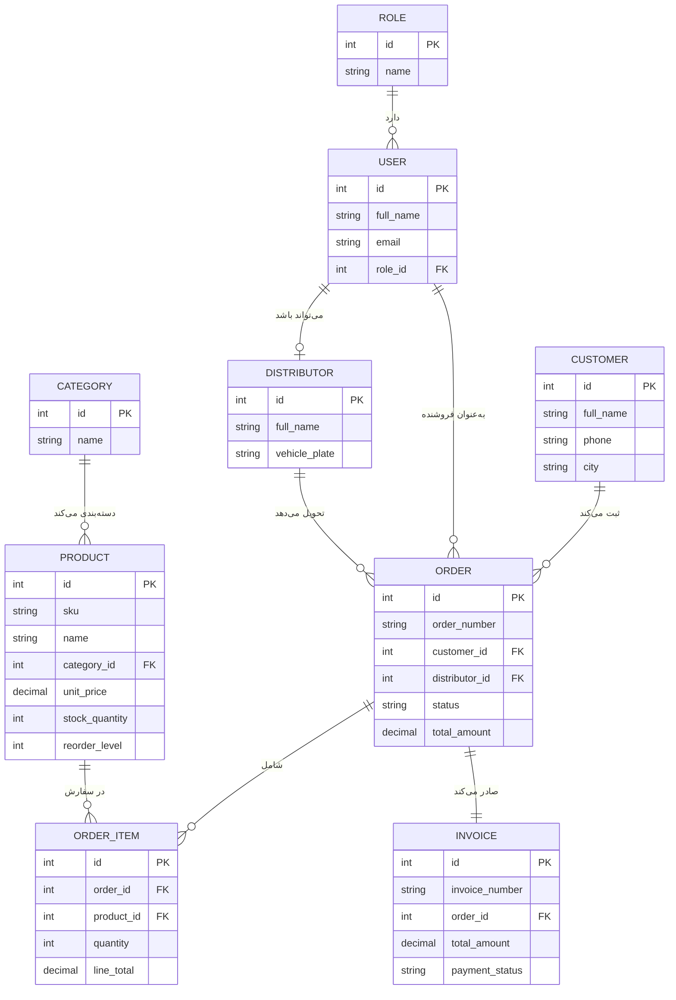
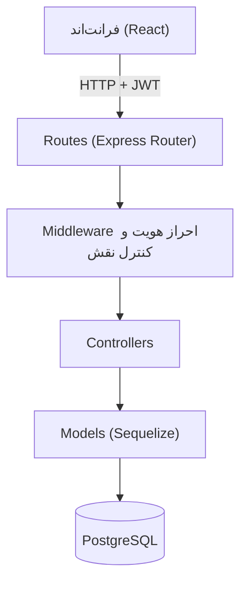
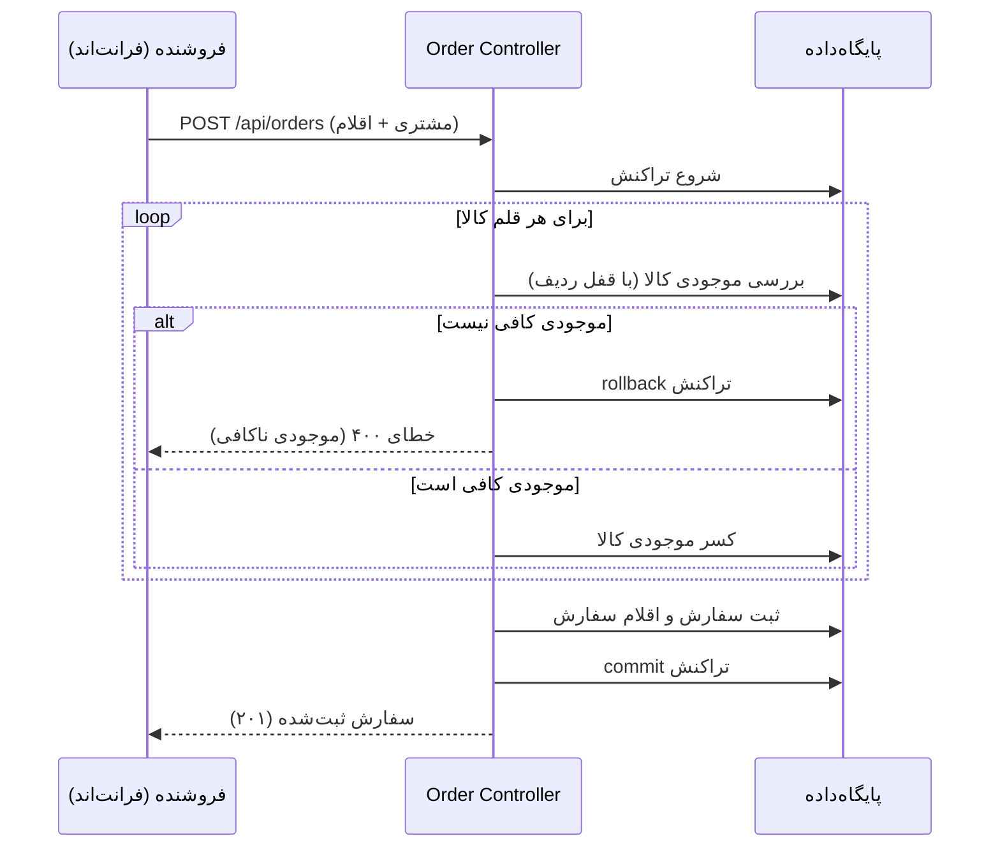

# معماری فنی سیستم مدیریت پخش کالا

## ۱. دیاگرام ارتباط جداول (ER Diagram)

## ۲. معماری لایه‌ای بک‌اند

## ۳. توالی ثبت سفارش (نمودار Sequence)

این نمودار نشان می‌دهد چگونه ثبت سفارش، بررسی موجودی، و کسر انبار در یک تراکنش واحد انجام می‌شود تا از ناهماهنگی داده جلوگیری شود.

## ۴. تصمیمات فنی کلیدی

- **تراکنش دیتابیس در ثبت سفارش**: بررسی موجودی و کسر آن در یک تراکنش Sequelize انجام می‌شود تا در صورت هم‌زمانی چند سفارش، موجودی هرگز منفی یا ناهماهنگ نشود.
- **حذف نرم (Soft Delete) برای کالا و توزیع‌کننده**: به‌جای حذف فیزیکی، فیلد `is_active` غیرفعال می‌شود تا سابقهٔ سفارش‌های گذشته که به این رکوردها ارجاع دارند حفظ شود.
- **جداسازی `app.js` از `index.js`**: تعریف اپلیکیشن Express از راه‌اندازی سرور جدا شده تا امکان تست خودکار (بدون نیاز به اتصال شبکه واقعی) فراهم شود.
- **کنترل دسترسی مبتنی بر نقش در سطح Middleware**: هر مسیر مشخص می‌کند کدام نقش‌ها مجاز به دسترسی هستند، نه در سطح Controller، تا منطق دسترسی متمرکز و قابل‌ممیزی باشد.
